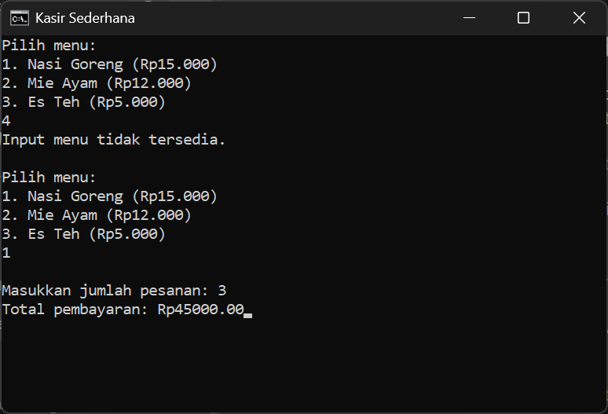

# Kasir Sederhana

A simple cashier (point-of-sale) program in C for a small food stall. The interface is in Bahasa Indonesia.



## Menu
| No | Item | Price |
|---|---|---|
| 1 | Nasi Goreng | Rp15.000 |
| 2 | Mie Ayam | Rp12.000 |
| 3 | Es Teh | Rp5.000 |

## How it works
1. Pick a menu item (an invalid choice asks again)
2. Enter the quantity
3. The program shows the total payment

## Build and run
The project file is for Code::Blocks (`Menu Kasir Sederhana.cbp`). You can also build it with GCC:

```bash
gcc main.c -o kasir.exe
kasir.exe
```

## License
Released under the [MIT License](LICENSE).
